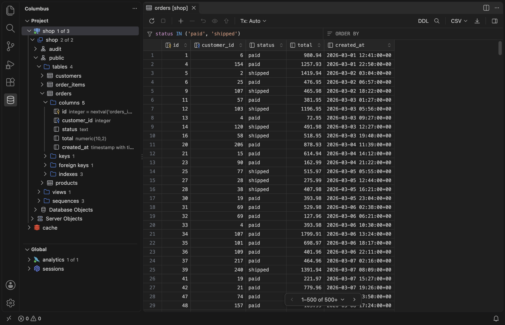
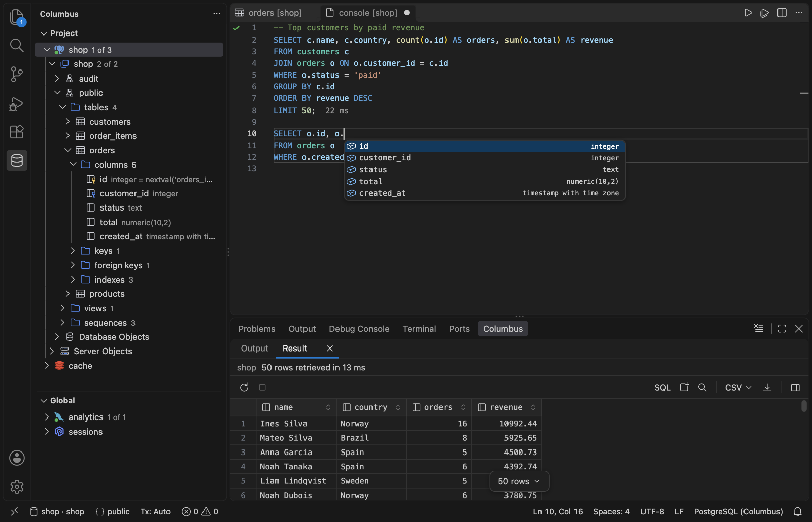
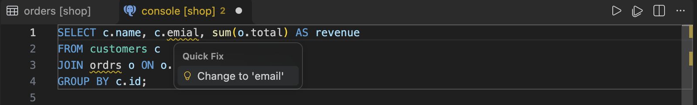
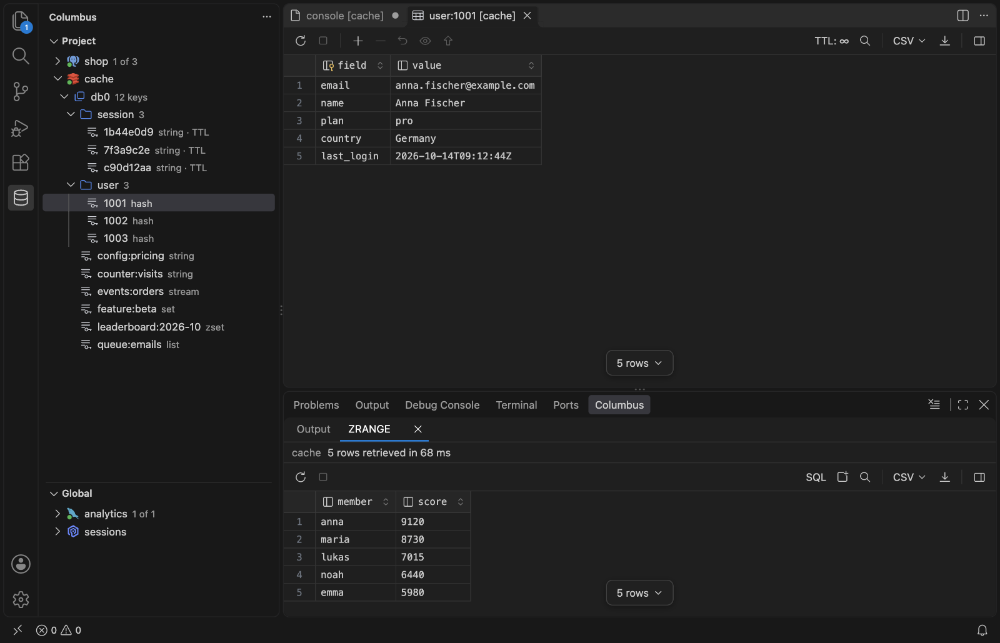
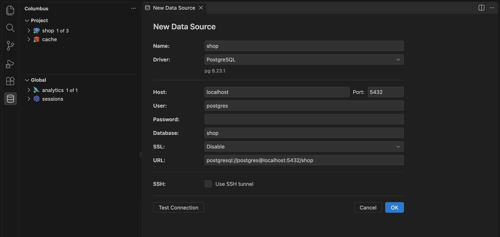

# Columbus

A database client for VS Code in the spirit of DataGrip. Browse PostgreSQL, MySQL, MariaDB, SQLite, Redis, Valkey and Dragonfly from one explorer, edit data in a fast grid, and write SQL with completion, highlighting and checks that know your schema.

> Columbus is in early development. Feedback and bug reports are welcome in [GitHub Issues](https://github.com/hopleus/vscode-columbus/issues).

## Supported databases

| Database | Tested with | What you get |
| --- | --- | --- |
| PostgreSQL | 13, 18 | Explorer, data editor, query console |
| MySQL | 8.0 | Explorer, data editor, query console |
| MariaDB | 11.4 | Explorer, data editor, query console |
| SQLite | 3.53 (the engine built into VS Code) | Explorer, data editor, query console |
| Redis | 7.4, also as a cluster or behind Sentinel | Key browser, key editor, Redis console |
| Valkey | 8.1 | Key browser, key editor, Redis console |
| Dragonfly | 1.37, 2.0 | Key browser, key editor, Redis console |

## Features

### Database Explorer

- One tree for every data source: database → schema → tables, views, materialized views, foreign tables, routines, sequences and object types (enums, composite types, domains, ranges); tables → columns, keys, foreign keys, indexes, checks and triggers, with types and defaults. Hovering a table lists its columns.
- **Database Objects** lists the installed extensions, **Server Objects** the roles and tablespaces of a PostgreSQL server.
- A click on a routine, sequence, type, trigger or any other object opens its DDL in a preview tab; **Generate DDL**, **Copy Name** and **Drop** work on all of them.
- Materialized views have **Refresh Materialized View…**, which reloads their open tabs.
- A PostgreSQL data source can show several databases of its server: `2 of 3` next to it counts them, **Choose Databases…** picks them.
- Each data source shows the icon of its server, and a green dot while it is connected. **Disconnect** closes the connections but keeps the tree and the open tabs.
- `1 of 3` next to a data source or a database tells how many schemas are shown; **Choose Schemas…** picks them.
- In SQLite, dropping a key or a foreign key rebuilds the table with its data, indexes and triggers, as SQLite cannot drop constraints.
- The context menu has **Edit Data**, **New** (console, table, view, column, index), **SQL Scripts** (DDL, `SELECT`, `INSERT`, `UPDATE`, `DELETE`), **Generate DDL**, **Copy Name**, **Export Data**, **Rename**, **Truncate** and **Drop**. Statements that change the database show their SQL for confirmation first.

### Data editor

- A virtualized grid that loads page by page, with `WHERE` and `ORDER BY` fields that highlight and complete SQL, sorting from column headers, resizing and range selection.
- Edit cells in place, add, clone and delete rows, paste tab-separated data; changes stay highlighted until you **Submit** or **Revert** them, and 👁 previews the SQL that Submit would run.
- **Tx: Auto** commits every Submit, **Tx: Manual** keeps changes in a transaction until **Commit** or **Rollback**.
- The cell menu sets NULL, DEFAULT or an SQL expression such as `now()`, opens the value editor (formatted JSON), copies in any format, filters by the value, goes to the row a foreign key points to, and shows the record or aggregates of the selection.
- Copy and export through data extractors: CSV, TSV, JSON, SQL inserts and Markdown. Exports read the table through a server-side cursor, so large tables do not slow down page after page.

### Query console

- One console per data source, kept between sessions, running on its own connection so `BEGIN … COMMIT`, `SET` and temporary tables work across statements.
- `Ctrl+Enter` runs the statement under the cursor or the selection; `Ctrl+Shift+Enter` runs the whole console. A frame marks the statement that would run, and the gutter shows ✓ or ✗ with the time of each statement.
- Completion follows the grammar of PostgreSQL or MySQL: the keywords that fit the clause, tables after `FROM` and `JOIN`, columns of every table in scope including aliases, CTEs and subqueries, the `ON` condition from a foreign key, column lists of `INSERT` and `UPDATE … SET`, and the functions of the database.
- Tables, columns and aliases are colored by meaning; unknown tables and columns are underlined with the closest names as quick fixes, and the quick fix on `*` expands it into the column list.

- The status bar switches the database of a PostgreSQL console, the current schema (`SET search_path` / `USE`) and the transaction mode, with Commit and Rollback in the editor title. A console opened from a database node starts in that database.
- Results open in the **Columbus** panel, one tab per result set, with the same grid, find and export as a table. `SELECT` results are fetched from the server page by page, so sorting and export cover the whole result. **SQL** shows the query of a result, and **Open in Editor Tab** keeps it in a tab of its own.
- A running statement can be cancelled with ■ or `Ctrl+F2` / `⌘F2`.

### Redis, Valkey and Dragonfly

- Databases with key counts, keys grouped into folders by `:` with their type and a `TTL` mark, and **Filter Keys…** with a `SCAN` pattern.
- Standalone servers, clusters (keys of every master, commands routed by slot) and Sentinel (the current master by its name, followed through a failover). With TLS, every cluster node, Sentinel and master is checked against its own host name. A connection lost for longer than a few retries opens again on the next action.
- Every key opens in the grid: strings and JSON as one value, hashes as field / value, lists with their index, sets, sorted sets with scores and streams. Binary key names, strings, fields, values and members show as `0x…` hex and are saved as the same bytes; a column with one binary value shows all its values in hex. Edits run as one `MULTI` and can be previewed; the remaining time to live counts down in the toolbar and changes with a click.
- **New Key…**, **Rename Key…**, **Set Time to Live…**, **Delete** and **Open as Text** in the context menu.
- The Redis console runs one command per line with redis-cli quoting, shows replies as rows, switches the database from the status bar and completes commands with their syntax, their options and key names. On a cluster, `WATCH` and `MULTI` … `EXEC` run on the node that holds the key, like `redis-cli -c`.

### Connections

- The form keeps the fields and a connection URL in sync: paste `postgresql://`, `mysql://`, `redis://`, `rediss://`, `redis+cluster://`, `redis+sentinel://host:26379/master/0`, `valkey://` or `sqlite:` URLs or fill in the fields.
- SQLite consoles and transactions of the data editor run in a process of their own: a running statement stops at once when cancelled, and the rest of the data source keeps working meanwhile.
- SQLite data sources point to a database file, chosen with **…** or created with **+**; relative paths start from the first workspace folder. Attached databases show up as schemas next to `main`.
- **SSH tunnel** with a password, a key pair (with a passphrase) or the SSH agent. The first connection shows the key fingerprint of the SSH host and remembers it once you trust it; a changed key is reported before connecting. Redis clusters and Sentinel work through the tunnel too: every node, master or replica address the server reports gets a forward of its own, also when a node joins later or a replica becomes the master. A dropped SSH connection opens again on the next action, and a database the SSH host cannot reach is named in the error.
- **Test Connection** shows the server version and can be stopped. SSL modes: disable, require, verify CA, verify CA and host, with a CA file and a client certificate and key; PostgreSQL and MySQL URLs carry them as `sslrootcert` / `sslcert` / `sslkey` and `ssl-ca` / `ssl-cert` / `ssl-key`.
- Passwords and SSH passphrases are kept in VS Code secret storage.
- Data sources are split into **Project** and **Global** sections, like project and global data sources in DataGrip. Project data sources, their schema filters and consoles are kept in a `.columbus` folder in the first workspace folder and move with it; the folder ignores itself in git and is hidden from the Explorer (`columbus.hideProjectFolder`), and `columbus.storage: internal` keeps them in VS Code storage instead. Global data sources are shown in every window. **Make Global** and **Make Project** in the context menu, or dragging a data source to the other section, move it with its filters and consoles; passwords stay as they are.

### Drivers

- Drivers are not bundled and never download by themselves. The form shows the version of the downloaded driver, or a **Download** link with its size, or **Update** when a new Columbus version needs newer files.
- A data source without its driver shows **Download missing driver files** in Database Explorer, and connecting to it offers the download in a notification.
- **Manage Drivers** in the `…` menu of Database Explorer lists every driver with its version and can download, update or delete its files, or install them from a file: download `columbus-driver-<name>.js` from the [GitHub release](https://github.com/hopleus/vscode-columbus/releases) of your Columbus version, and its completion files next to it are picked up too.
- Driver files are checked against SHA-256 checksums built into the extension and run in a separate worker thread.
- SQLite uses the SQLite engine built into VS Code (Node.js 22.16 or newer), so its driver file is only a few kilobytes; its completion engine is the one of PostgreSQL.

## Getting started

1. Open **Columbus** in the Activity Bar.
2. Click **+** (Add Data Source), choose the driver, fill in the connection or paste a URL, and press **OK**.
3. If the form says the driver files are missing, click **Download** (0.1–3 MB from the GitHub release of your Columbus version).
4. Expand the data source to browse it, use **Edit Data** (`⌘↓` / `Ctrl+↓`) on a table, or **Open Query Console** (`⇧⌘L` / `Ctrl+Shift+L`).

## Keyboard shortcuts

| Key | Action |
| --- | --- |
| `Ctrl+Enter` in a console | Run the statement under the cursor or the selection |
| `Ctrl+Shift+Enter` in a console | Run all statements |
| `⌘F2` / `Ctrl+F2` | Cancel the running statement |
| `⌘.` / `Ctrl+.` in a console | Quick fixes: similar names, expand `*` |
| `Enter`, `F2` or typing in the grid | Edit the cell |
| `⌘↩` / `Ctrl+Enter` in the grid | Submit changes |
| `⌘N` / `Ctrl+N`, `⌘D` / `Ctrl+D` | Add a row, clone the selected rows |
| `⌘⌫` / `Ctrl+Backspace` | Delete the selected rows |
| `⌥⌘Z` / `Ctrl+Alt+Z` | Revert the selected rows |
| `⌘C` / `⌘V` | Copy with the chosen data extractor, paste tab-separated cells |
| `⌘F` / `Ctrl+F`, `F3`, `⇧F3` | Find in the loaded rows |
| `⇧↩`, `⌘⇧↩` in the grid | Value editor, record view |
| `⌘R` / `Ctrl+R` | Reload the page |
| `⌘↓` / `Ctrl+↓`, `F2`, `⌘⌫` / `Ctrl+Backspace`, `⇧⌘L` / `Ctrl+Shift+L` in Database Explorer | Edit data, rename, drop, open the console |

## Privacy

Columbus collects no telemetry. Connections go only to the databases you configure; the only other requests download driver files from the project's GitHub releases, and only when you click **Download** or **Update**.

## Contributing

Build, test and project layout are described in [CONTRIBUTING.md](CONTRIBUTING.md). Changes are listed in [CHANGELOG.md](CHANGELOG.md).

## License

[MIT](LICENSE)
